<div align="center">

# 🛍️ AB Ecommerce Platform

### 🇧🇩 A Modern Multi-Vendor E-Commerce Platform for Bangladesh

<p>
  
  
  
  
  
</p>

<p>
  
  
  
  
</p>

<p>
  <strong>AB Ecommerce Platform</strong> is a modern multi-vendor marketplace designed for the Bangladeshi e-commerce ecosystem.
</p>

<p>
  🛒 Customer Shopping &nbsp; • &nbsp;
  🏪 Merchant Management &nbsp; • &nbsp;
  👑 Admin Control &nbsp; • &nbsp;
  🔥 Firebase Integration
</p>

</div>

---

# 📌 Table of Contents

- [📖 About The Project](#-about-the-project)
- [✨ Features](#-features)
- [👥 User Roles](#-user-roles)
- [📸 Screenshots](#-screenshots)
- [🛠️ Tech Stack](#️-tech-stack)
- [🏗️ Project Architecture](#️-project-architecture)
- [📂 Project Structure](#-project-structure)
- [🔥 Firebase Integration](#-firebase-integration)
- [⚙️ Installation](#️-installation)
- [🔐 Environment Variables](#-environment-variables)
- [🚀 Running the Project](#-running-the-project)
- [📦 Production Build](#-production-build)
- [🌐 Firebase Hosting](#-firebase-hosting)
- [🛒 Customer Features](#-customer-features)
- [🏪 Merchant Features](#-merchant-features)
- [👑 Admin Features](#-admin-features)
- [💳 Payment Methods](#-payment-methods)
- [🔒 Security](#-security)
- [🚧 Future Improvements](#-future-improvements)
- [🤝 Contributing](#-contributing)
- [📄 License](#-license)
- [👨‍💻 Author](#-author)

---

# 📖 About The Project

**AB Ecommerce Platform** is a modern multi-vendor e-commerce web application designed around the needs of the Bangladeshi online shopping market.

The platform provides separate experiences for:

- 🛍️ Customers
- 🏪 Merchants
- 👑 Administrators

Customers can browse products, search and filter products, manage their shopping cart, complete checkout, track orders, and communicate with the platform.

Merchants can manage products, monitor orders, and request payouts.

Administrators can manage merchants, users, products, orders, system settings, and merchant payout requests.

The application uses **React + TypeScript + Vite** for the frontend and **Firebase** for backend-related services.

---

# ✨ Features

## 🛍️ Customer Features

- 🔍 Product search
- 🗂️ Product category filtering
- 🛒 Shopping cart
- ➕ Increase/decrease cart quantity
- ❌ Remove products from cart
- 📦 Checkout system
- 🚚 Order tracking
- 👤 Customer authentication
- 💬 Contact / Drop Message
- 🇧🇩 Bangladesh-focused product marketplace
- 📱 Responsive design
- 🌐 English / Bangla language support
- 💳 bKash payment support
- 💰 Nagad payment support
- 💵 Cash on Delivery

---

## 🏪 Merchant Features

- 🏪 Merchant dashboard
- ➕ Add products
- 📦 View merchant products
- 📋 Monitor orders
- 🔄 Update order status
- 💰 Request payouts
- 📊 Merchant sales information
- 🏷️ Product variants
- 📈 Merchant performance information

---

## 👑 Admin Features

- 👥 User management
- 🏪 Merchant management
- 🛡️ Merchant moderation
- 📦 Product management
- 📋 Order management
- 💰 Payout management
- ✅ Approve merchant requests
- ❌ Suspend/reject merchants
- 💳 Payout approval/rejection
- ⚙️ System settings
- 📊 Marketplace administration

---

# 👥 User Roles

The platform contains three main application roles.

| Role | Main Responsibilities |
|------|------------------------|
| 🛍️ Customer | Browse, purchase and track products |
| 🏪 Merchant | Manage products, orders and payouts |
| 👑 Admin | Manage the complete marketplace |

---

# 📸 Screenshots

## 🔐 Authentication

### Sign In Page

<p align="center">
  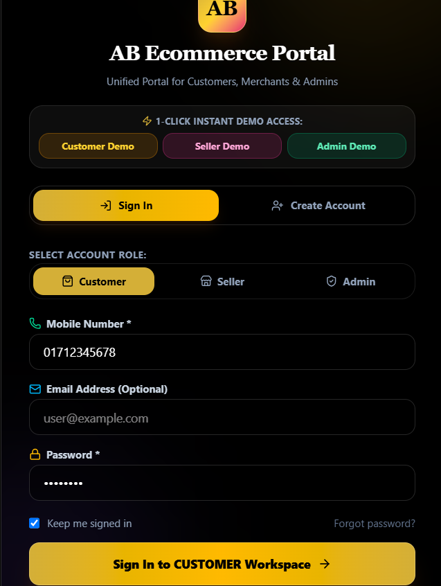
</p>

---

# 🛍️ Customer Experience

## 🛒 Product Marketplace

<p align="center">
  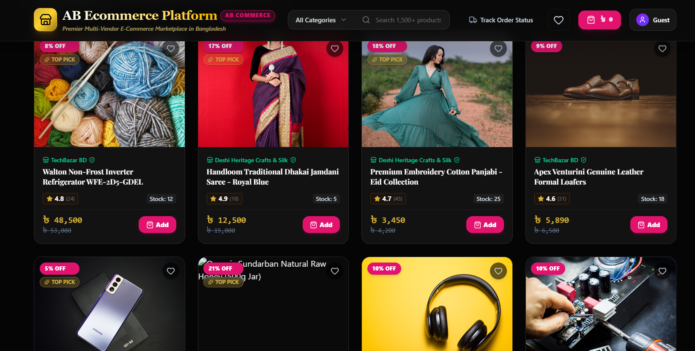
</p>

The customer storefront provides:

- Product browsing
- Search
- Category filtering
- Product cards
- Product information
- Add to cart functionality

---

## 🛒 Shopping Cart

<p align="center">
  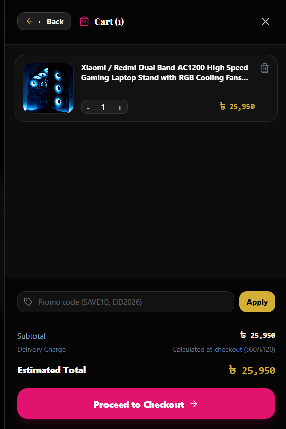
</p>

Customers can:

- View cart items
- Change quantities
- Remove products
- Review cart totals
- Continue to checkout

---

## 💳 Checkout

<p align="center">
  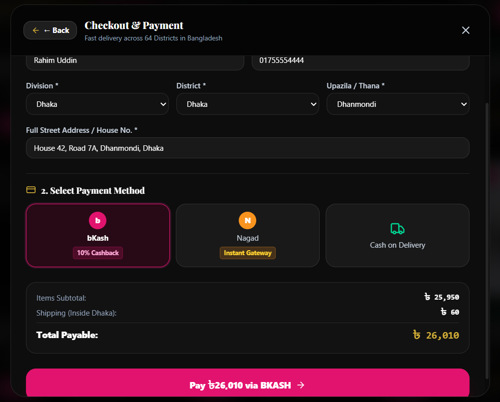
</p>

The checkout interface provides:

- Customer information
- Shipping address
- Order summary
- Payment method selection
- Order confirmation

---

## 📦 Order Tracker

<p align="center">
  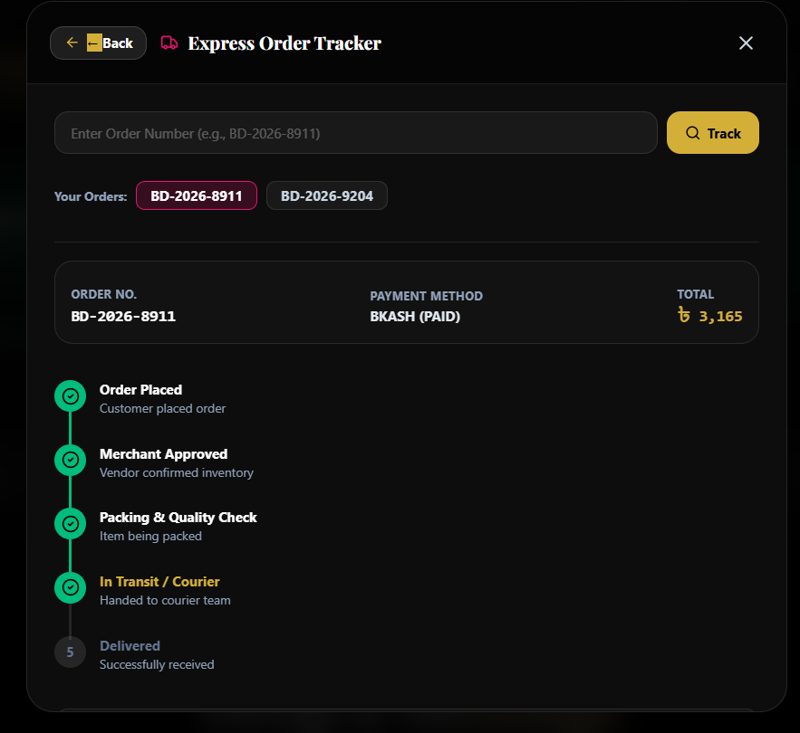
</p>

Customers can monitor order progress through different order statuses.

---

## 👤 Customer Dashboard

<p align="center">
  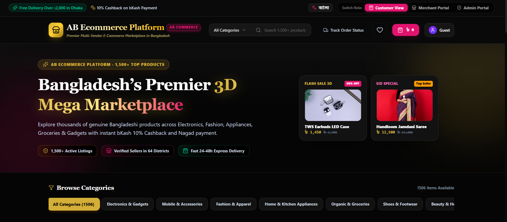
</p>

The customer experience includes access to shopping and order-related functionality.

---

## 💬 Drop Message

<p align="center">
  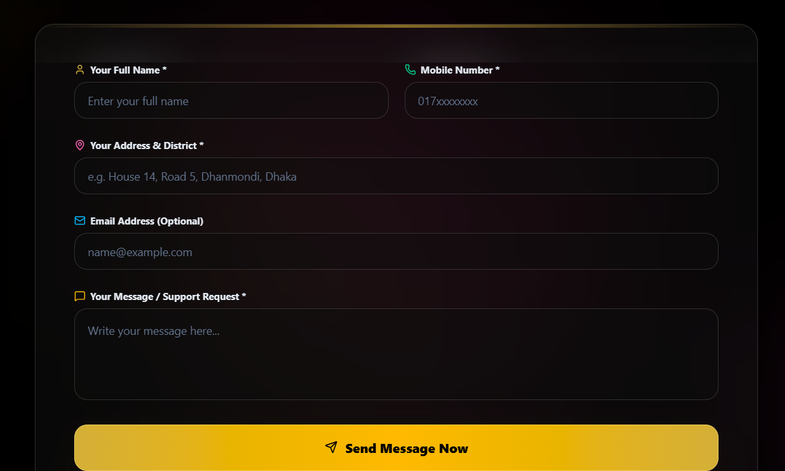
</p>

Customers can send messages to the store/platform for support or inquiries.

---

# 🏪 Merchant Dashboard

<p align="center">
  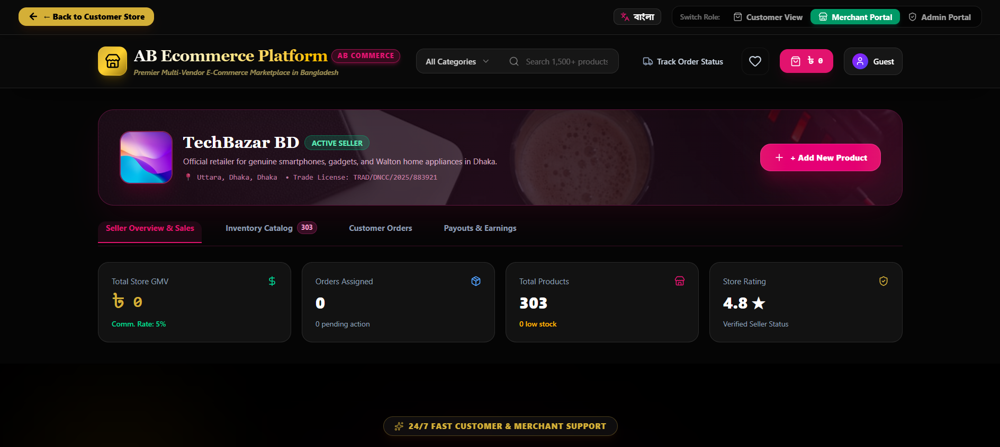
</p>

The merchant dashboard provides tools for managing the seller side of the marketplace.

Merchants can:

- Add products
- View products
- Manage orders
- Update order status
- Request payouts
- Monitor merchant activity

---

# 👑 Admin Dashboard

<p align="center">
  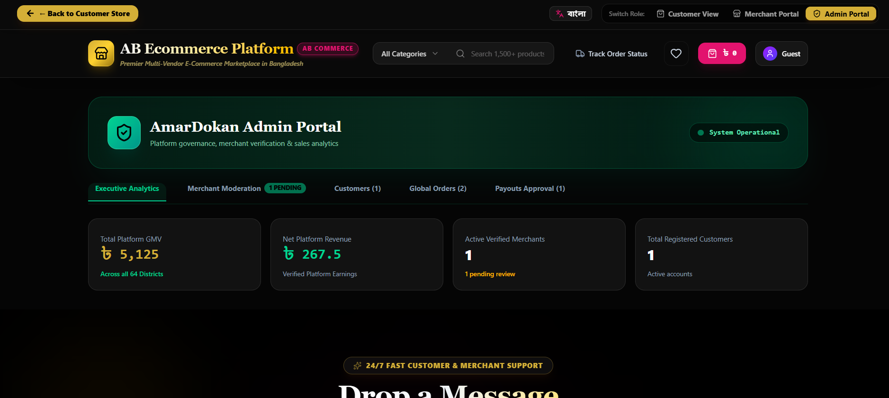
</p>

The admin dashboard provides centralized control over the marketplace.

---

## 🏪 Admin Merchant Moderation

<p align="center">
  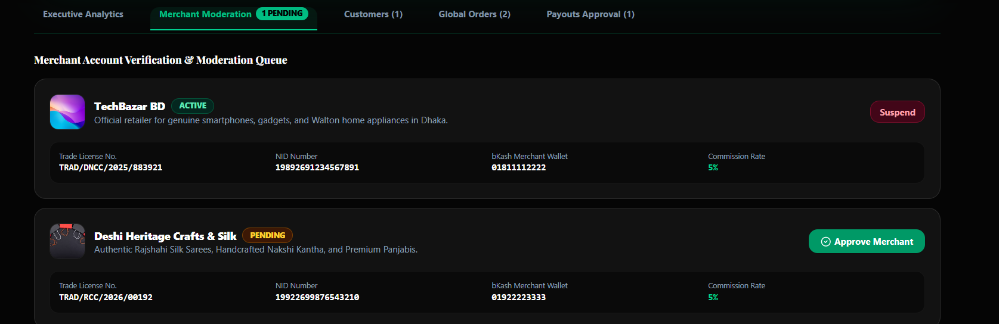
</p>

Administrators can manage merchant accounts and their marketplace status.

Possible merchant states include:

- Active
- Pending
- Suspended
- Rejected

---

## 💰 Admin Payout Approval

<p align="center">
  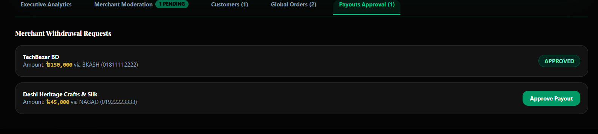
</p>

Administrators can review merchant payout requests and approve or reject them.

---

# 🛠️ Tech Stack

## Frontend

| Technology | Purpose |
|------------|---------|
| ⚛️ React | User interface |
| 📘 TypeScript | Type-safe development |
| ⚡ Vite | Development server and build tool |
| 🎨 Tailwind CSS | UI styling |
| 🎯 Lucide React | Icons |

---

## Backend / Cloud

| Technology | Purpose |
|------------|---------|
| 🔥 Firebase | Backend services |
| 🔐 Firebase Authentication | User authentication |
| 🗄️ Firebase Firestore | Database |
| ☁️ Firebase Hosting | Deployment |

---

## Development Tools

- Git
- GitHub
- VS Code
- npm
- Firebase Console

---

# 🏗️ Project Architecture

The application follows a component-based React architecture.

```text
                    ┌─────────────────────┐
                    │      AB Ecommerce   │
                    │       Platform      │
                    └──────────┬──────────┘
                               │
              ┌────────────────┼────────────────┐
              │                │                │
              ▼                ▼                ▼
        ┌───────────┐    ┌───────────┐    ┌───────────┐
        │ Customer  │    │ Merchant  │    │   Admin   │
        └─────┬─────┘    └─────┬─────┘    └─────┬─────┘
              │                │                │
              └────────────────┼────────────────┘
                               │
                               ▼
                     ┌──────────────────┐
                     │     React App    │
                     └────────┬─────────┘
                              │
                       ┌──────┴──────┐
                       │             │
                       ▼             ▼
                  Components     Application
                                   State
                       │             │
                       └──────┬──────┘
                              │
                              ▼
                     ┌─────────────────┐
                     │    Firebase     │
                     └─────────────────┘
